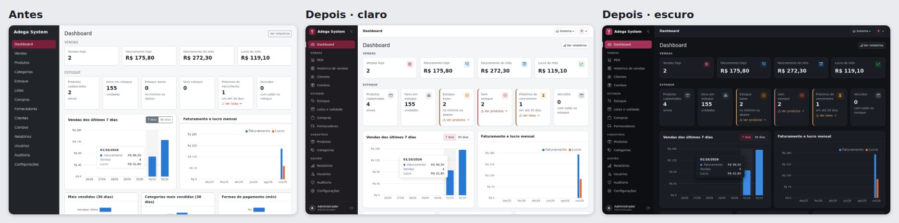
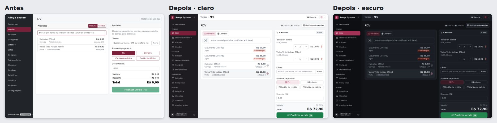
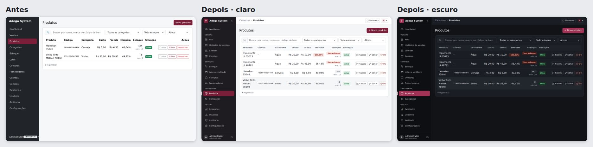
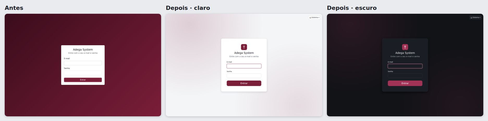
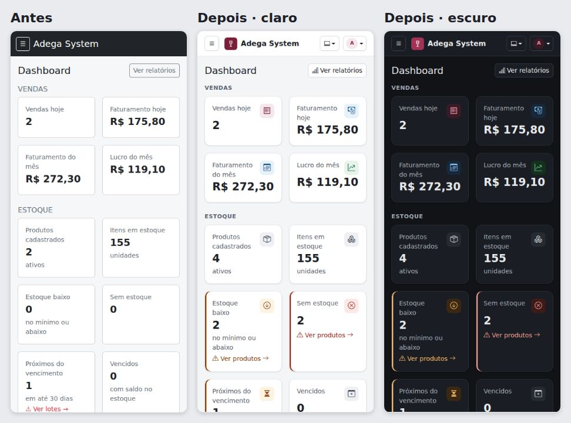
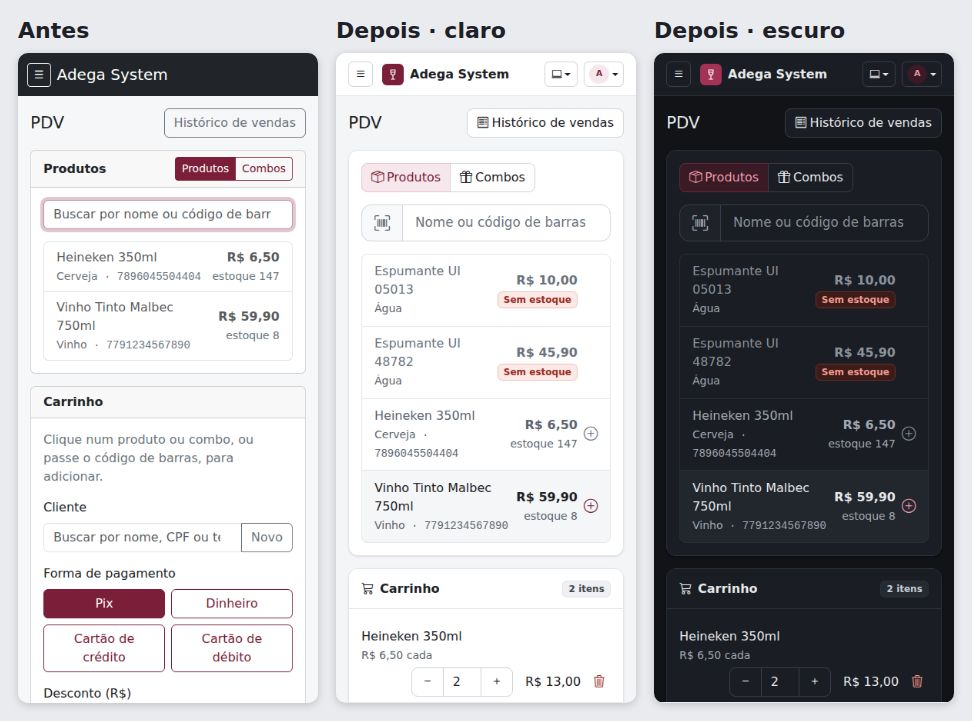
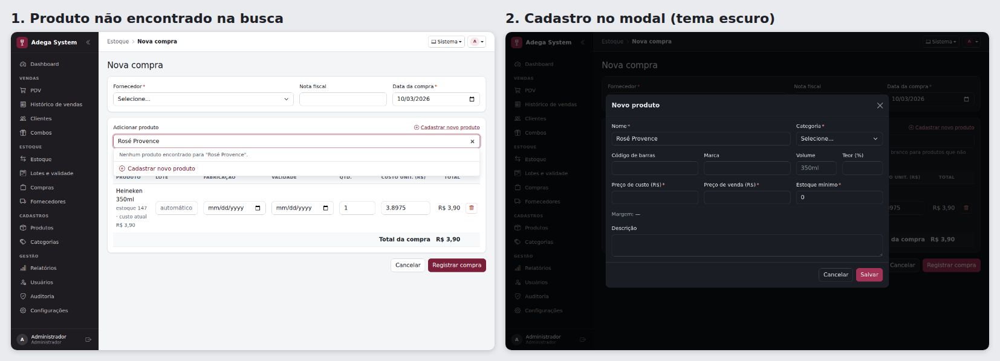

# Etapa de UI/UX: tema claro/escuro, layout e experiência de uso (guia de estudo)

Esta etapa veio depois das 8 fases do plano. Ela mexe só no **frontend**: nenhuma regra de negócio, cálculo,
permissão ou endpoint mudou, e o backend não foi tocado (os 341 testes continuam passando).

O que mudou, em resumo:

1. **Tema** claro, escuro ou "seguir o sistema", com cores centralizadas em tokens.
2. **Layout**: menu lateral agrupado, com ícones e recolhível, e uma barra superior.
3. **Componentes padronizados**: cards do dashboard, tabelas, botões de ação, campos obrigatórios, estados (vazio, erro, acesso negado).
4. **PDV** reorganizado: busca em destaque, carrinho preso na tela e total grande ao lado do botão de finalizar.
5. **Cadastro rápido de produto** dentro da Nova compra, reaproveitando o formulário e a API de Produtos.

A auditoria visual feita antes de começar está em `AUDITORIA-VISUAL.md` (na pasta do projeto).

## Antes e depois

| Tela | Imagem |
| --- | --- |
| Dashboard |  |
| PDV |  |
| Produtos |  |
| Login |  |
| Celular: dashboard |  |
| Celular: PDV |  |
| Cadastro rápido na compra |  |

---

## 1. Como o tema funciona

O fluxo inteiro tem um dono só, o `ThemeProvider`:

```
preferência (claro | escuro | sistema)  →  localStorage ("adega.theme")
        ↓
tema resolvido (claro | escuro)   ← sistema operacional, quando a preferência é "sistema"
        ↓
<html data-bs-theme="dark">  →  o Bootstrap e os nossos tokens trocam as cores
```

### `src/theme/` (quatro arquivos pequenos, o mesmo padrão do `auth/`)

| Arquivo | O que faz |
| --- | --- |
| `themeStorage.ts` | Lê e grava a preferência no `localStorage`. "Sistema" apaga a chave (é o padrão). O `try/catch` cobre navegador que bloqueia armazenamento. |
| `themeContext.ts` | O formato do contexto: `preference`, `theme` (já resolvido) e `setPreference`. |
| `ThemeProvider.tsx` | Guarda a preferência, escuta o `prefers-color-scheme` do sistema operacional e grava `data-bs-theme` e `color-scheme` no `<html>`. |
| `useTheme.ts` | O hook para ler o tema. Dá erro claro se alguém usar fora do provider. |
| `ThemeToggle.tsx` | O menu "Claro / Escuro / Sistema" da barra superior (e do login). |

O `main.tsx` envolve o `<App />` com o `<ThemeProvider>`.

**Por que nenhum componente sabe qual é o tema?** Porque todas as cores são variáveis CSS. Quando o atributo do `<html>`
muda, o navegador recalcula as variáveis e a tela inteira troca na hora, sem renderizar nada de novo. Isso evita o
"if (dark)" espalhado pelo código.

### O script do `index.html`

O React só carrega depois do HTML. Sem cuidado, quem usa o tema escuro veria um "flash" branco a cada F5. O
`index.html` tem um script de 6 linhas que lê a mesma chave do `localStorage` (ou o `prefers-color-scheme`) e já
coloca o `data-bs-theme` no `<html>` antes de qualquer coisa aparecer.

### Tokens: `src/styles/tokens.css`

É o **único** arquivo com valores de cor. Cada token tem um valor no claro e outro no escuro:

```css
:root, [data-bs-theme='light'] { --surface: #ffffff; --text-primary: #1d2127; --primary: #7b1e3a; ... }
[data-bs-theme='dark']         { --surface: #1a1d23; --text-primary: #e6e8eb; --primary: #a33356; ... }
```

Os grupos: fundos e superfícies (`--bg-primary`, `--surface`, `--border-color`), texto (`--text-primary`,
`--text-secondary`), marca (`--primary`, `--primary-text`, `--primary-subtle`), estados (`--success`, `--warning`,
`--danger`, `--info`, cada um com `-text` e `-subtle`), menu lateral, gráficos e forma (raios, sombras, foco).

No fim do arquivo os tokens **alimentam as variáveis do Bootstrap** (`--bs-body-bg: var(--surface)` etc.). Por isso
os componentes do React Bootstrap (botões, campos, modais, tabelas, alertas) seguem o tema sem nenhuma mudança nas telas.

> **Para trocar uma cor**, mude o token nos dois blocos (claro e escuro) e confira o contraste. Os pares de texto
> foram conferidos com a regra WCAG AA (≥ 4,5:1). Exemplos: branco sobre o vinho `#7b1e3a` dá 10:1; o rosa
> `#f09bb0` (links no escuro) sobre o cartão escuro dá 8:1.

**Por que o vinho muda no escuro?** O `#7b1e3a` é escuro demais sobre fundo quase preto (botão "some"). No escuro,
botões usam `#a33356` e textos/links usam um rosa claro (`--primary-text`).

### `src/styles/theme.css`

Usa só tokens (nenhuma cor fixa). Define o visual dos componentes: botões, cartões, tabelas (cabeçalho leve, hover
suave), campos, selos em tom suave, alertas com ícone, modais, abas, paginação e o foco do teclado. No fim, o bloco
`prefers-reduced-motion` desliga animações para quem pediu isso no sistema operacional.

### Gráficos: `components/charts/chartTheme.ts`

O Recharts recebe as cores por propriedade (`fill`, `stroke`). Em vez de ler o tema no componente, passamos a
variável: `series1: 'var(--chart-series-1)'`. O navegador resolve o `var(...)` dentro do SVG, então o gráfico troca de
cor junto com o resto. O azul e o laranja foram ajustados para o fundo escuro e conferidos de novo com um validador
de daltonismo.

---

## 2. Layout

### `layouts/menu.ts`: o menu como dados

O menu virou uma lista de grupos (Vendas, Estoque, Cadastros, Gestão), cada item com rótulo, rota, ícone e perfis
que o veem. O `AdminLayout` só desenha essa lista. Um grupo sem nenhum item visível para o perfil some inteiro (o
vendedor não vê "Estoque"). A função `pageInfo` devolve o título e o grupo da página atual, usados na barra superior
e no título da aba.

### `layouts/AdminLayout.tsx`

- **Menu lateral** escuro nos dois temas, com o item atual destacado (fundo vinho e uma barrinha à esquerda, para não depender só da cor).
- **Recolher**: o botão `«` deixa só os ícones. A escolha fica no `localStorage` ("adega.sidebar"). Recolhido, o texto do item
  fica escondido na tela mas continua para o leitor de tela.
- **Rodapé do menu**: iniciais, nome, perfil e o botão de sair.
- **Barra superior**: no desktop, "Grupo › Página" discreto (a página já tem o próprio título); no celular, a marca.
  À direita, o seletor de tema e o menu da conta (alterar senha, sair).
- **Celular/tablet**: o menu vira gaveta (Offcanvas), igual a antes.

Ícones: **Bootstrap Icons** (`bootstrap-icons`), a biblioteca oficial do Bootstrap. Uso: `<i className="bi bi-cart3" aria-hidden="true" />`.
O `aria-hidden` esconde o ícone do leitor de tela, porque o texto ao lado já diz o que é. Botões só com ícone levam `aria-label`.

---

## 3. Componentes padronizados

| Componente | O que mudou |
| --- | --- |
| `StatCard` | Ganhou `icon` e `tone` (neutral, primary, info, success, warning, danger). Com algo a resolver (estoque baixo, vencidos), o card ganha uma faixa fina na cor do tom e o aviso "⚠ Ver produtos →" em texto, nunca só cor. |
| `ActionButton` (novo) | Botão de ação de linha de tabela: ícone + texto em tela larga, só ícone nas menores (o texto fica no `title` e no `aria-label`). Editar e ver usam `outline-secondary`; desativar e dar baixa usam `outline-danger` e continuam pedindo confirmação. |
| `RequiredMark` / `FieldLabel` (novos) | O asterisco de obrigatório padronizado. Na tela aparece só o `*`; o leitor de tela lê "(obrigatório)". `FieldLabel` converte rótulos que terminam com " *". |
| `EmptyState` | Ganhou ícone. Também é usado para "Página não encontrada" e "Acesso negado". |
| `ErrorState` (novo) | Erro ao carregar uma tela inteira (dashboard, relatórios). Se a API não responde, mostra "Servidor indisponível" com ícone próprio; o dashboard tem "Tentar de novo". |
| `AppAlert` | Mensagens de sucesso somem sozinhas depois de 6 segundos; erros ficam até o usuário fechar. |
| Alertas | Todo alerta ganhou um ícone pelo CSS (sucesso ✓, erro, aviso, informação), sem mudar as telas. |
| `RequireAuth` | "Acesso negado" com ícone, explicação e o botão "Voltar ao início". |
| Tabelas | No celular, colunas secundárias (código, categoria, custo, contato...) se escondem com `d-none d-md-table-cell`; o resto rola. A Auditoria continua em cartões. |

Selos (badges) usam fundo suave e texto escuro (ou o contrário no tema escuro). Os antigos `bg="light" text="dark"`,
que ficariam "acesos" no escuro, viraram `bg="neutral"`.

---

## 4. PDV (`pages/sales/PosPage.tsx` + `PosPage.css`)

Só a parte visual mudou; o carrinho, a conferência de estoque e a venda são os mesmos.

- Busca grande, com ícone de código de barras, e o seletor Produtos/Combos acima dela.
- Cada produto mostra preço, estoque discreto (selo amarelo quando está baixo) e um "+" de adicionar.
- **Carrinho preso na tela** no desktop (`position: sticky`): a lista de itens e os campos rolam por dentro e o rodapé
  com subtotal, desconto, **total grande** e o botão **Finalizar venda** fica sempre visível.
- Botões de quantidade maiores (bons para tablet) e remover com ícone de lixeira.
- Desconto aparece numa linha própria (em verde) só quando existe.
- Formas de pagamento com ícone; o botão de finalizar desabilitado fica cinza, em vez de um verde "fraco".
- Dicas `F2 buscar · F9 finalizar` discretas, só em tela grande.

---

## 5. Cadastro rápido de produto na Nova compra

**Problema:** ao lançar uma nota com um produto novo, a única saída era abandonar a compra e ir para Produtos.

**Fluxo novo:**

1. Na busca de produto, quando nada é encontrado, a lista mostra "Nenhum produto encontrado" e a opção
   **Cadastrar novo produto** (também há um link fixo acima da busca).
2. Abre o **mesmo** `ProductFormModal` da tela de Produtos, com o nome já preenchido com o texto buscado.
3. Ao salvar, o modal fecha, o produto entra como uma linha nova da compra e os outros itens continuam como estavam.

**Por que não duplica regra?** O modal é o mesmo componente e chama a mesma API (`POST /api/products`), então as
validações do backend (FluentValidation) e do formulário valem igual. Se a API recusar, o modal continua aberto com
os valores digitados e o erro no campo.

Arquivos:

- `components/ProductPicker.tsx`: nova propriedade opcional `onCreateNew(texto)`. O picker guarda para qual busca
  os resultados vieram (`results.search`), para não dizer "nenhum produto" antes de a resposta chegar.
- `pages/products/ProductFormModal.tsx`: aceita `initialName` e devolve o produto salvo no `onSaved(mensagem, produto)`
  (a tela de Produtos ignora o segundo parâmetro).
- `pages/purchases/PurchaseFormPage.tsx`: abre o modal, busca as categorias só na primeira vez e, ao salvar, chama o
  mesmo `addProduct` usado quando o produto é escolhido na busca.

A opção só aparece para quem pode cadastrar produto (`access.catalogWrite`: ADMIN e ESTOQUISTA, os mesmos perfis de Compras).

---

## 6. Acessibilidade

- Contraste AA conferido nos dois temas (texto normal e secundário).
- Foco do teclado sempre visível (`:focus-visible`), inclusive no menu escuro, onde o contorno é rosa claro.
- Ícones decorativos com `aria-hidden`; botões só de ícone com `aria-label`.
- Estado nunca só por cor: selos dizem "Sem estoque", "baixo", "vencido"; cards de alerta têm texto; o item ativo do menu tem a barrinha.
- Animações curtas (hover, menu, alertas), desligadas com `prefers-reduced-motion`.

---

## 7. Como testar

```bash
cd frontend
npm run lint
npm run build
npm run dev
```

1. Abra o sistema e use o menu de tema da barra superior: Claro, Escuro e Sistema. Recarregue (F5): a escolha continua.
   Com "Sistema", troque o tema do Windows e veja o sistema acompanhar.
2. Passe pelas telas nos dois temas: dashboard (gráficos e tooltip), tabelas, modais, PDV, relatórios, configurações, auditoria e login.
3. Recolha o menu (`«`) e recarregue: ele continua recolhido.
4. Entre como ADMIN, VENDEDOR e ESTOQUISTA: o menu mostra só os grupos de cada perfil; uma rota de outro perfil mostra "Acesso negado".
5. Em Compras → Nova compra, busque um nome que não existe, clique em "Cadastrar novo produto", salve e confira que o
   produto entrou na lista sem apagar os outros itens.
6. Diminua a janela (ou use o modo celular do navegador, F12): menu em gaveta, colunas secundárias escondidas e PDV em uma coluna.
