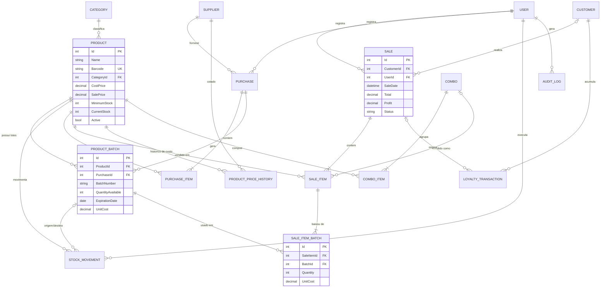

# Adega System: Plano de Arquitetura

> Documento de planejamento aprovado em 01/10/2026. É a referência das próximas fases.

---

## 0. Decisões principais (resumo)

| Tema | Escolha | Alternativa considerada | Por quê |
|---|---|---|---|
| Versão do .NET | **.NET 10 (LTS)** | .NET 8 | O .NET 8 sai de suporte em 10/11/2026, ou seja, daqui a um mês. O .NET 10 é a LTS atual (suporte até nov/2028). |
| Provider MySQL do EF Core | **MySql.EntityFrameworkCore (Oracle) 10.x** | Pomelo | O Pomelo é o favorito da comunidade, mas a última versão estável dele é a 9.0 (EF Core 9). O provider oficial da Oracle já tem versão estável para EF Core 10. Se você preferir Pomelo, o caminho é .NET 8 + Pomelo 8.0.3. |
| Organização do backend | **Um projeto Web API organizado em camadas por pasta** + um projeto de testes | Clean Architecture com 4 projetos (Domain, Application, Infrastructure, Api) | Para estudar, um projeto só com pastas bem definidas é muito mais fácil de navegar. As camadas continuam separadas (Controller → Service → Data), só que sem a cerimônia de 4 `.csproj`. Se o sistema crescer, dá para extrair projetos depois sem reescrever. |
| Repository Pattern | **Não criar repositório genérico. Services usam o `AdegaDbContext` diretamente.** | `IRepository<T>` genérico + Unit of Work | O `DbContext` do EF Core **já é** um Unit of Work e cada `DbSet<T>` já é um repositório. Um repositório genérico por cima só repassa chamadas e esconde recursos úteis (Include, projeções, transações). Se alguma consulta ficar grande e repetida (relatórios, por exemplo), extraímos uma classe de consulta específica. |
| Validação | **FluentValidation** | DataAnnotations | Regras ficam em classes separadas, testáveis e legíveis (`RuleFor(x => x.SalePrice).GreaterThan(0)`). |
| Mapeamento | **Mapeamento manual (métodos de extensão `ToDto()`)** | AutoMapper | Com poucos DTOs por entidade, o mapeamento manual é explícito, rápido e você vê exatamente o que acontece. O AutoMapper também passou a ter licença comercial em 2025. Reavaliamos se ficar repetitivo demais. |
| Estoque | **`Product.CurrentStock` guardado no banco** (cache), sempre igual à soma de `ProductBatch.QuantityAvailable` | Calcular o estoque somando lotes a cada consulta | Listagens e filtros de estoque baixo ficam rápidos. A regra “só o service mexe no estoque, dentro de transação, gerando movimentação” garante a consistência. |
| Devolução para o lote certo | **Nova entidade `SaleItemBatch`** (quanto de cada lote foi usado em cada item) | Guardar só o produto | Sem isso, o cancelamento não sabe para quais lotes devolver as unidades. É uma entidade que o enunciado não pediu, mas a regra de cancelamento exige. |
| Usuário antes do login | **Entidade `User` + admin semeado já na Fase 2**, com um `ICurrentUserService` | Deixar `UserId` nulo até a Fase 5 | Compras e movimentações exigem `UserId` desde a Fase 2, mas o JWT só chega na Fase 5. Até lá o `ICurrentUserService` devolve o admin semeado; na Fase 5 ele passa a ler o usuário do token, e nada mais muda. |
| Enums no banco | **Gravados como texto** (`SALE`, `PIX`...) | Inteiros | O banco fica legível em consultas manuais e relatórios. |
| Frontend | **Vite + React + TypeScript + React Bootstrap + Axios + React Router + Recharts** | Create React App, Material UI, Chart.js | CRA foi descontinuado; Vite é o padrão atual. Bootstrap é simples de aprender. Recharts é declarativo e combina com React. |
| MySQL em desenvolvimento | **`docker-compose.yml` com MySQL 9.7** | Instalar o MySQL na máquina | Um comando sobe o banco. Se você já tem MySQL instalado, basta apontar a connection string para ele. |

---

## 1. Arquitetura proposta

```
┌────────────────────────┐        HTTP/JSON (Axios)       ┌──────────────────────────────────────┐
│  frontend (React + TS) │ ─────────────────────────────▶ │  backend (ASP.NET Core Web API)      │
│  Vite, React Router,   │ ◀───────────────────────────── │                                      │
│  React Bootstrap,      │     { success, message,        │  Middleware (erros, JWT, CORS)       │
│  Recharts              │       data, errors }           │        ↓                             │
└────────────────────────┘                                │  Controllers  (só HTTP: rota, status)│
                                                          │        ↓  DTOs                       │
                                                          │  Validators (FluentValidation)       │
                                                          │        ↓                             │
                                                          │  Services  (regras de negócio,       │
                                                          │             transações)              │
                                                          │        ↓  Entities                   │
                                                          │  AdegaDbContext (EF Core + Fluent API) │
                                                          └──────────────────┬───────────────────┘
                                                                             ↓
                                                                     ┌──────────────┐
                                                                     │   MySQL 9.7    │
                                                                     └──────────────┘
```

**Responsabilidade de cada camada**

- **Controller**: recebe a requisição, chama o service, devolve o status HTTP. Não tem regra de negócio e nunca recebe ou devolve entidades, só DTOs.
- **Validator**: valida o formato da entrada (campos obrigatórios, tamanhos, valores positivos). Roda antes do service.
- **Service**: onde moram as regras (estoque nunca negativo, FEFO, cálculo de lucro). Abre transação quando a operação mexe em várias tabelas.
- **AdegaDbContext**: mapeamento das tabelas, índices e relacionamentos (Fluent API). Acesso ao banco.
- **Middleware de exceções**: transforma qualquer erro na resposta padrão. Os services lançam exceções de domínio (`BusinessException("Estoque insuficiente.")`, `NotFoundException`), e o middleware converte em 400/404 com o JSON padronizado.

**Resposta padrão da API**

```json
{ "success": true,  "message": null, "data": { ... }, "errors": [] }
{ "success": false, "message": "Estoque insuficiente.", "data": null, "errors": [] }
```

Listagens paginadas devolvem em `data`:
```json
{ "items": [ ... ], "page": 1, "pageSize": 20, "totalItems": 134, "totalPages": 7 }
```

---

## 2. Estrutura de pastas

```
adega-system/
├── README.md
├── .gitignore
├── .env.example                  # variáveis do docker-compose (sem valores reais)
├── docker-compose.yml            # MySQL para desenvolvimento
├── docs/
│   └── PLANO.md
├── backend/
│   ├── AdegaSystem.sln
│   ├── src/AdegaSystem.Api/
│   │   ├── Program.cs            # composição: DI, middleware, Swagger, CORS, JWT
│   │   ├── appsettings.json      # sem senhas; connection string vem de User Secrets / env
│   │   ├── Controllers/          # ProductsController, CategoriesController, ...
│   │   ├── Services/             # ProductService, SaleService, ... (interface + implementação)
│   │   ├── Data/
│   │   │   ├── AdegaDbContext.cs
│   │   │   ├── Configurations/   # IEntityTypeConfiguration<T> por entidade (Fluent API)
│   │   │   ├── Migrations/
│   │   │   └── Seed/             # categorias iniciais, usuário admin
│   │   ├── Entities/             # Product, Category, Sale, ... (+ Enums/)
│   │   ├── DTOs/                 # agrupados por módulo: DTOs/Products/CreateProductDto.cs ...
│   │   ├── Validators/           # CreateProductDtoValidator, ...
│   │   ├── Mappings/             # métodos ToDto() por módulo
│   │   ├── Common/               # ApiResponse, PagedResult, exceções de domínio, paginação
│   │   ├── Middleware/           # ExceptionHandlingMiddleware
│   │   └── Reports/              # (Fase 6) consultas de relatório + IReportExporter (futuro Excel/PDF)
│   └── tests/AdegaSystem.Tests/  # xUnit, testes dos services com SQLite em memória
└── frontend/
    ├── package.json, vite.config.ts, tsconfig.json
    ├── .env.example              # VITE_API_URL
    └── src/
        ├── main.tsx, App.tsx
        ├── api/                  # axios instance (baseURL, token, tratamento de erro) + um arquivo por recurso
        ├── types/                # tipos TS espelhando os DTOs
        ├── components/           # Button, Modal, DataTable, Pagination, SearchInput, ConfirmDialog, Alert, Loading, EmptyState
        ├── layouts/              # AdminLayout (menu lateral + topo)
        ├── pages/                # Dashboard, Products, Categories, Sales/Pos, ...
        ├── hooks/                # useDebounce, usePagedQuery, ...
        ├── contexts/             # AuthContext (Fase 5)
        └── routes/               # rotas + rota protegida por role
```

**Por que testes com SQLite em memória e não com o provider InMemory do EF?** O InMemory não suporta transações nem respeita restrições relacionais, e as regras mais importantes do sistema (venda com rollback) dependem justamente disso. O SQLite em memória é real o bastante e continua rápido.

---

## 3. Entidades do sistema

Convenções para todas as entidades:
- `Id` inteiro auto-incremento.
- Datas em **UTC** (`DateTime`). Datas sem hora (validade, fabricação, nascimento) como `DateOnly`.
- Dinheiro como `decimal(12,2)`; custos unitários como `decimal(12,4)` (custo de R$ 3,8975 por unidade numa caixa é comum).
- **Soft delete**: entidades de cadastro têm `Active`. `DELETE` na API apenas desativa.
- Vendas, compras, movimentações e logs **nunca** são apagados nem editados.

| Entidade | Campos (além dos do enunciado) | Fase |
|---|---|---|
| **Category** | Id, Name (único), Description, Active, CreatedAt | 1 |
| **Product** | Id, Name, Description, Barcode (único quando preenchido), Brand, CategoryId, Volume (texto, ex.: "350ml"), AlcoholContent `decimal(5,2)` nulo, CostPrice, SalePrice, MinimumStock, CurrentStock, Active, CreatedAt, UpdatedAt. Calculados no DTO (não gravados): `IsLowStock`, `IsOutOfStock`, `MarginPercent` | 1 |
| **User** | Id, Name, Email (único), PasswordHash, Role (`ADMIN`, `VENDEDOR`, `ESTOQUISTA`), Active, CreatedAt | 2 (entidade e seed) / 5 (login) |
| **Supplier** | Id, Name, CorporateName, Cnpj (único), Phone, Email, Address, Active, CreatedAt | 2 |
| **Purchase** | Id, SupplierId, InvoiceNumber, PurchaseDate, TotalAmount, UserId, CreatedAt | 2 |
| **PurchaseItem** | Id, PurchaseId, ProductId, Quantity, UnitCost, Total + `BatchNumber`, `ManufacturingDate`, `ExpirationDate` (para criar o lote) | 2 / 3 |
| **StockMovement** | Id, ProductId, BatchId (nulo), MovementType, Quantity, PreviousStock, NewStock, Reason, UserId, CreatedAt + `ReferenceType`/`ReferenceId` (ex.: "Sale", 1024) | 2 |
| **ProductBatch** | Id, ProductId, PurchaseId (nulo, para ajustes), BatchNumber, QuantityReceived, QuantityAvailable, ManufacturingDate, ExpirationDate, UnitCost, CreatedAt | 3 |
| **Customer** | Id, Name, Cpf (único quando preenchido), Phone, Email, BirthDate, Active, CreatedAt | 4 |
| **Sale** | Id, CustomerId (nulo), UserId, SaleDate, Subtotal, Discount, Total, PaymentMethod, Status + `TotalCost`, `Profit`, `CanceledAt`, `CanceledByUserId`, `CancelReason` | 4 |
| **SaleItem** | Id, SaleId, ProductId, Quantity, UnitPrice, CostPrice (custo médio dos lotes usados), Discount, Total + `ComboId` (nulo, Fase 7) | 4 |
| **SaleItemBatch** *(nova)* | Id, SaleItemId, BatchId, Quantity, UnitCost | 4 |
| **ProductPriceHistory** | Id, ProductId, SupplierId, PurchaseId, CostPrice, Date | 7 (mas gravado desde a Fase 2, ver nota) |
| **Combo** / **ComboItem** | Combo: Id, Name, Description, SalePrice, Active, CreatedAt. ComboItem: Id, ComboId, ProductId, Quantity | 7 |
| **LoyaltyTransaction** | Id, CustomerId, Points, Type (`EARN`, `REDEEM`, `ADJUSTMENT`), SaleId (nulo), CreatedAt | 7 |
| **AuditLog** | Id, UserId, Action, Entity, EntityId, OldValue (JSON), NewValue (JSON), CreatedAt | 7 |
| **SystemSetting** *(nova)* | Id, Key (único), Value. Ex.: `MinimumMarginPercent = 15`, `LoyaltyAmountPerPoint = 10` | 6 / 7 |

**Nota sobre histórico de preços:** a tabela é de Fase 7, mas é barato criá-la na Fase 2 e gravar uma linha a cada compra. Assim, quando chegarmos na tela de evolução de preços, já haverá histórico real. Sugiro fazer isso.

**Enums**
- `MovementType`: PURCHASE, SALE, ADJUSTMENT, LOSS, EXPIRED, RETURN
- `PaymentMethod`: PIX, CASH, CREDIT_CARD, DEBIT_CARD
- `SaleStatus`: COMPLETED, CANCELED
- `UserRole`: ADMIN, VENDEDOR, ESTOQUISTA
- `LoyaltyType`: EARN, REDEEM, ADJUSTMENT

---

## 4. Relacionamentos

| Relação | Cardinalidade | Ao excluir o pai |
|---|---|---|
| Category → Product | 1 : N | **Restrict** (categoria com produtos não pode ser apagada; só desativada) |
| Product → ProductBatch | 1 : N | Restrict |
| Product → StockMovement | 1 : N | Restrict |
| ProductBatch → StockMovement | 1 : N (opcional) | Restrict |
| Supplier → Purchase | 1 : N | Restrict |
| Purchase → PurchaseItem | 1 : N | Cascade (itens não existem sem a compra, e compras não são apagadas mesmo) |
| Purchase → ProductBatch | 1 : N | Restrict |
| Product → PurchaseItem | 1 : N | Restrict |
| Customer → Sale | 1 : N (opcional) | Restrict |
| Sale → SaleItem | 1 : N | Cascade |
| SaleItem → SaleItemBatch | 1 : N | Cascade |
| ProductBatch → SaleItemBatch | 1 : N | Restrict |
| User → Purchase / Sale / StockMovement / AuditLog | 1 : N | Restrict |
| Product / Supplier / Purchase → ProductPriceHistory | 1 : N | Restrict |
| Combo → ComboItem | 1 : N | Cascade |
| Product → ComboItem | 1 : N | Restrict |
| Customer → LoyaltyTransaction | 1 : N | Restrict |

Regra geral: **Restrict por padrão**. Cascade só entre “documento” e seus itens. Como nada importante é apagado fisicamente, o cascade quase nunca será acionado, mas configurá-lo assim evita acidentes.

---

## 5. Diagrama conceitual do banco



**Índices planejados**

| Tabela | Índice | Motivo |
|---|---|---|
| Products | `Barcode` (único, filtrado quando não nulo) | busca no PDV pelo leitor |
| Products | `Name` | busca por nome |
| Products | `CategoryId` | filtro por categoria |
| Categories | `Name` (único) | evitar duplicadas |
| Customers | `Cpf` (único) | busca e unicidade |
| Suppliers | `Cnpj` (único) | busca e unicidade |
| ProductBatches | `ExpirationDate`; `(ProductId, ExpirationDate)` | consultas de validade e seleção FEFO |
| Sales | `SaleDate`; `(Status, SaleDate)` | relatórios por período ignorando canceladas |
| StockMovements | `CreatedAt`; `ProductId` | histórico |
| Users | `Email` (único) | login |

---

## 6. Endpoints principais da API

Todos com prefixo `/api`. `DELETE` sempre faz soft delete. Listagens aceitam `?page=1&pageSize=20&search=...`.

**Fase 1: Categorias e Produtos**
```
GET    /categories                    ?search=&active=
GET    /categories/{id}
POST   /categories
PUT    /categories/{id}
DELETE /categories/{id}               (desativa)

GET    /products                      ?search=&categoryId=&active=&page=&pageSize=
GET    /products/{id}
GET    /products/barcode/{barcode}
GET    /products/low-stock
GET    /products/out-of-stock
POST   /products
PUT    /products/{id}                 (não altera CurrentStock: estoque só muda por movimentação)
DELETE /products/{id}                 (desativa)
```

**Fase 2: Fornecedores, Compras, Movimentações**
```
GET/POST/PUT/DELETE /suppliers[/{id}]
GET    /suppliers/{id}/purchases      histórico
GET    /suppliers/{id}/summary        total comprado + produtos mais comprados
GET    /purchases                     ?supplierId=&from=&to=
GET    /purchases/{id}
POST   /purchases                     cria e finaliza (estoque, movimentação, lote, custo)
GET    /stock-movements               ?productId=&type=&from=&to=
POST   /stock/adjustments             ajuste manual / perda (ADJUSTMENT, LOSS)
```

**Fase 3: Lotes e Validade**
```
GET    /batches                       ?productId=
GET    /batches/expired
GET    /batches/expiring?days=7|30|60
POST   /batches/{id}/write-off        baixa de lote vencido (EXPIRED)
```

**Fase 4: Clientes e Vendas**
```
GET/POST/PUT/DELETE /customers[/{id}]
GET    /customers/{id}/summary        nº compras, total gasto, última compra, ticket médio
GET    /sales                         ?from=&to=&status=&customerId=
GET    /sales/{id}
POST   /sales                         venda completa com FEFO, numa transação
POST   /sales/{id}/cancel             { "reason": "..." }
```

**Fase 5: Autenticação e Usuários**
```
POST   /auth/login
POST   /auth/register                 (somente ADMIN)
GET    /auth/me
GET/POST/PUT/DELETE /users[/{id}]     (somente ADMIN)
```

**Fase 6: Dashboard e Relatórios**
```
GET    /dashboard
GET    /reports/sales                 ?from=&to=
GET    /reports/profit                ?from=&to=&groupBy=day|month
GET    /reports/top-products          ?period=today|7d|30d|month|custom&from=&to=
GET    /reports/least-sold-products
GET    /reports/idle-products?days=30|60|90
GET    /reports/stock
GET    /reports/purchases-by-supplier
GET    /reports/margins
GET    /reports/stock-movements
```

**Fase 7: Combos, Fidelidade, Auditoria, Preços**
```
GET/POST/PUT/DELETE /combos[/{id}]
GET    /customers/{id}/loyalty        saldo + extrato
POST   /customers/{id}/loyalty/redeem
GET    /audit-logs                    ?entity=&userId=&from=&to=
GET    /products/{id}/price-history   evolução + % de aumento
GET/PUT /settings
```

**Permissões por role (aplicadas na Fase 5)**

| Recurso | ADMIN | ESTOQUISTA | VENDEDOR |
|---|---|---|---|
| Usuários, Configurações, Auditoria | ✓ | | |
| Produtos / Categorias (escrita) | ✓ | ✓ | |
| Produtos / Categorias (leitura) | ✓ | ✓ | ✓ |
| Estoque, Lotes, Compras, Fornecedores | ✓ | ✓ | |
| Vendas (criar) | ✓ | | ✓ |
| Vendas (cancelar) | ✓ | | |
| Clientes (leitura) | ✓ | | ✓ |
| Clientes (escrita) | ✓ | | ✓ (cadastro rápido no PDV) |
| Dashboard / Relatórios | ✓ | | |

> Decisão para você confirmar mais tarde: deixei **cancelar venda só para ADMIN** e permiti ao **VENDEDOR cadastrar cliente** no PDV. O enunciado diz apenas “consultar clientes”.

---

## 7. Fluxos críticos (prévia)

**Regra de arquitetura aprovada (01/10/2026): estoque centralizado.** Nenhum service, controller ou tela altera `Product.CurrentStock` ou `ProductBatch.QuantityAvailable` por conta própria. Toda entrada e saída passa por um único `StockService` (Fase 2), com métodos como `AddToBatchAsync` e `RemoveFromBatchAsync`. Cada chamada atualiza o lote, o `CurrentStock` do produto e grava o `StockMovement` correspondente, sempre dentro da transação aberta por quem chamou (`PurchaseService`, `SaleService`, ajustes, baixa de vencidos). Na Fase 1, `CurrentStock` nasce com 0 e não aparece nos DTOs de criação e edição. Para reforçar a regra no código, o setter de `CurrentStock` fica `internal` ou privado, e só o `StockService` tem um caminho para mudá-lo.

**POST /api/sales** (Fase 4)
```
SalesController
  ↓ CreateSaleDto validado (itens > 0, quantidades > 0, desconto ≥ 0)
SaleService.CreateAsync
  ↓ BEGIN TRANSACTION
  ↓ carrega produtos ativos
  ↓ para cada item: lotes com QuantityAvailable > 0 e ExpirationDate >= hoje, ordenados por validade (FEFO)
  ↓ soma disponível < pedido? → BusinessException("Estoque insuficiente para X") → ROLLBACK
  ↓ consome lote a lote, criando SaleItemBatch para cada um
  ↓ CostPrice do item = média ponderada dos custos dos lotes usados
  ↓ Product.CurrentStock -= qtd  (nunca < 0)
  ↓ StockMovement SALE por lote (PreviousStock → NewStock, Reason "Venda #id")
  ↓ Subtotal, Discount, Total, TotalCost, Profit
  ↓ SaveChanges + COMMIT
  ↓ 201 Created + SaleDto
```

**Concorrência:** dois caixas vendendo a última unidade ao mesmo tempo. Vamos usar um **token de concorrência** em `ProductBatch` e `Product`: se outro processo alterou o lote entre a leitura e a gravação, o EF lança `DbUpdateConcurrencyException`, fazemos rollback e devolvemos “Estoque alterado por outra operação, tente novamente.” Explico isso em detalhe na Fase 4.

**POST /api/sales/{id}/cancel**: lê os `SaleItemBatch` da venda, devolve cada quantidade ao lote de origem, atualiza `CurrentStock`, gera movimentações `RETURN`, marca a venda como `CANCELED` com usuário, data e motivo. Tudo numa transação.

**Combos (Fase 7):** ao vender um combo, ele é “expandido” em um `SaleItem` por produto (com `ComboId` preenchido e o preço do combo rateado proporcionalmente ao preço normal de cada produto). Assim relatórios de produto mais vendido e lucro continuam funcionando sem caso especial.

---

## 8. Ordem de implementação

Segue a sua ordem, com o que cada fase entrega e o que a seguinte passa a ter disponível.

**Fase 1: Configuração, Banco, Categorias, Produtos** *(próxima)*

> **Atualização (01/10/2026):** o esqueleto (itens 1 a 5 e a parte de setup do item 10) sai num PR separado, com as versões estáveis mais recentes e sem preview/beta/RC: .NET 10 LTS, ASP.NET Core 10, EF Core 10, MySQL estável mais recente, React 19.x e React Bootstrap estável. A Fase 1 deste plano (Categorias e Produtos, itens 6 a 10) será construída em cima desse PR depois que ele existir.
1. Estrutura do monorepo: `README.md`, `.gitignore`, `.env.example`, `docker-compose.yml` (MySQL 9.7).
2. Solution .NET 10: `AdegaSystem.Api` + `AdegaSystem.Tests`.
3. Pacotes: EF Core 10, MySql.EntityFrameworkCore, FluentValidation, Swashbuckle (Swagger).
4. `Program.cs`: DI, Swagger, CORS para o frontend, middleware de exceções.
5. `Common/`: `ApiResponse<T>`, `PagedResult<T>`, `BusinessException`, `NotFoundException`.
6. Entidades `Category`, `Product` + configurações Fluent API + índices.
7. `AdegaDbContext`, migration inicial, seed das 10 categorias.
8. DTOs, validators, `CategoryService`, `ProductService`, controllers.
9. Testes iniciais (regras de estoque baixo/sem estoque, unicidade de código de barras).
10. Frontend: Vite + TS, `AdminLayout` com menu lateral, componentes base (Table, Pagination, SearchInput, Modal, ConfirmDialog, Alert, Loading, EmptyState), telas de **Categorias** e **Produtos** (listagem paginada, busca, filtro por categoria, cadastro/edição, desativação, badges de estoque baixo/sem estoque).

**Fase 2:** User (entidade + seed admin) e `ICurrentUserService`, Fornecedores, Compras com entrada de estoque, StockMovement, ajustes manuais, histórico de preço de custo gravado.
**Fase 3:** ProductBatch, criação de lote na compra, consultas de validade, baixa de vencidos, alertas de estoque mínimo.
**Fase 4:** Clientes, Vendas com FEFO e transação, SaleItemBatch, cancelamento, tela de PDV.
**Fase 5:** Login JWT, hash de senha (`PasswordHasher` do ASP.NET Identity, sem adotar o Identity inteiro), roles nos endpoints, telas de login e usuários, rotas protegidas no frontend.
**Fase 6:** Dashboard (cards e gráficos), relatórios, lucro, mais vendidos, produtos parados, margem mínima configurável.
**Fase 7:** Combos, fidelidade, auditoria, tela de histórico de preços.
**Fase 8:** Refinamento visual, ampliação de testes, README completo, deploy (Docker para API + front).

**Como cada fase será entregue:** um branch e um Pull Request por fase. No PR e no guia de estudo da fase, para cada arquivo: nome, caminho, para que serve e explicação das partes importantes, além do fluxo da requisição. O código completo fica no PR (fácil de revisar linha a linha no GitHub).

---

## 9. Segurança e configuração (desde a Fase 1)

- `appsettings.json` **não** contém senha. A connection string vem de:
  - desenvolvimento: `dotnet user-secrets set "ConnectionStrings:DefaultConnection" "..."`
  - produção/Docker: variável de ambiente `ConnectionStrings__DefaultConnection`
- O mesmo vale para `Jwt:Secret` na Fase 5.
- `.env` (com a senha do MySQL do docker-compose) está no `.gitignore`; apenas `.env.example` é versionado.
- DTOs de saída nunca incluem `PasswordHash` nem dados internos.

---

## 10. Pontos decididos (01/10/2026)

Aprovados por Gustavo: .NET 10 LTS, provider oficial da Oracle, um projeto Web API com pastas + testes, sem repositório genérico, SaleItemBatch, SystemSetting, admin semeado antes do JWT, cancelamento só ADMIN, VENDEDOR cadastra cliente no PDV.

### Perguntas originais

1. **.NET 10 + provider da Oracle** (recomendado) ou **.NET 8 + Pomelo**?
2. **Um projeto Web API com pastas** (recomendado) ou **Clean Architecture com 4 projetos**?
3. **Sem repositório genérico** (recomendado) ou quer o Repository Pattern explícito para estudar o padrão?
4. As permissões da seção 6 estão boas (cancelamento só ADMIN, vendedor cadastra cliente)?
